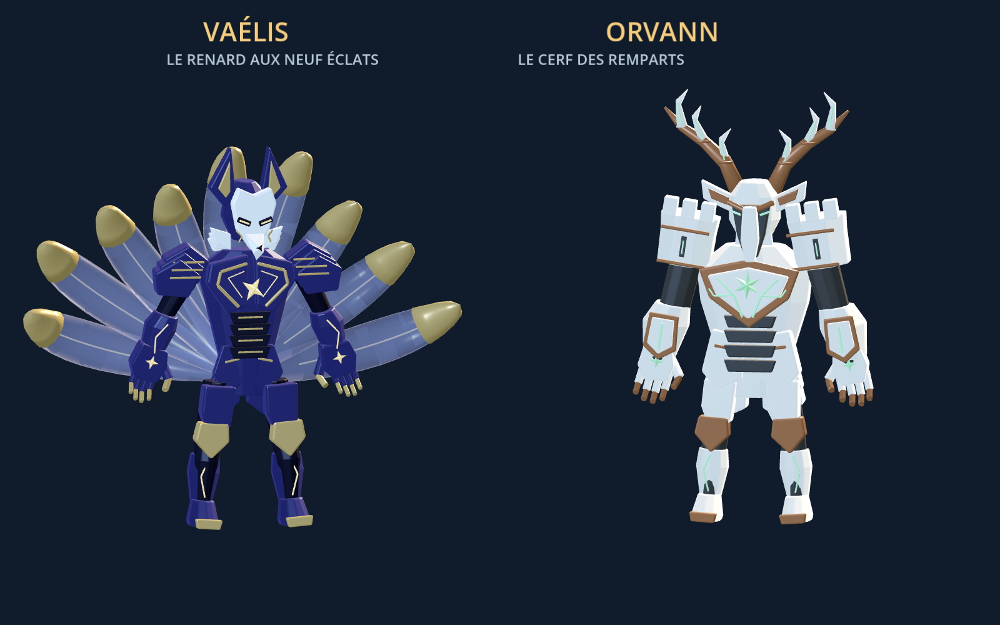
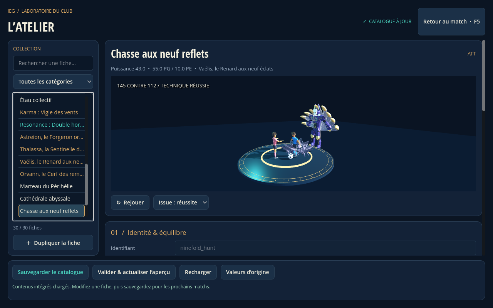
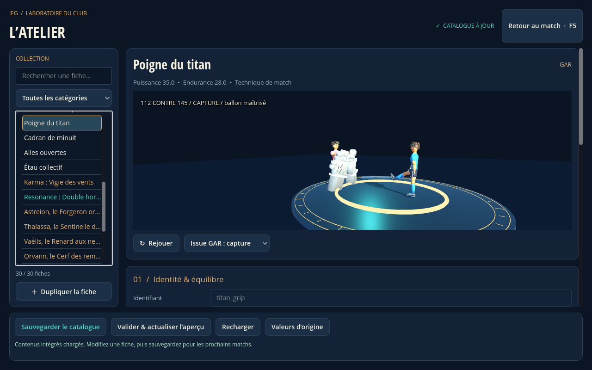

# Huit techniques, Vaélis et Orvann

Ce lot ajoute huit techniques ordinaires, deux Karma et leurs deux signatures au moteur de match existant. Godot standard **4.7 stable**, rendu Compatibility et GDScript restent utilisés. Le catalogue contient désormais **30 fiches**, dont **20 techniques de duel** : 16 ordinaires et quatre signatures. Les tactiques, Résonances et contenus historiques sont conservés.



## Techniques ordinaires

Les puissances sont les bonus de technique ajoutés au calcul de l'affrontement, pas son score total. Les coûts ci-dessous débitent l'énergie du joueur de champ, ou l'endurance du gardien pour celui-ci ; les dépenses ordinaires d'affrontement restent applicables. Les durées sont celles du catalogue : si les deux adversaires emploient une technique, la plus longue détermine la durée du duel.

| Technique et identifiant | Type | Puissance | Coût | Durée | Portée supplémentaire |
| --- | --- | ---: | ---: | ---: | ---: |
| Frappe sismique — `seismic_strike` | TIR | 36 | 28 | 3,8 s | +3 m |
| Ricochet prismatique — `prism_ricochet` | TIR, longue distance | 29 | 23 | 3,9 s | +12 m |
| Échappée de papier — `paper_escape` | ATT | 27 | 19 | 3,5 s | — |
| Syncope — `syncope` | ATT | 31 | 24 | 3,4 s | — |
| Rempart d’airain — `bronze_rampart` | DEF, blocage | 33 | 26 | 3,8 s | — |
| Ronces mécaniques — `mechanical_brambles` | DEF, intervention | 28 | 21 | 3,6 s | — |
| Poigne du titan — `titan_grip` | GAR | 35 | 28 | 4 s | — |
| Cadran de minuit — `midnight_dial` | GAR | 30 | 22 | 3,9 s | — |

**Frappe sismique** anime l'appui, sept plaques soulevées, les éclats et deux traînées qui accompagnent le ballon. **Ricochet prismatique** déploie trois prismes, leurs arêtes lumineuses et trois reflets du ballon qui convergent avant le résultat.

**Échappée de papier** associe une feinte du corps, deux doubles du joueur et trente feuilles. Les leurres s'effacent différemment selon le résultat. **Syncope** utilise trois impulsions au sol, des appuis décalés et une accélération visuelle.

**Rempart d’airain** assemble trois boucliers sculptés : ils encaissent ou se fragmentent après la révélation. **Ronces mécaniques** déploie six chaînes de segments, articulations et pointes ; la cage accompagne l'intervention et sa réussite ou sa rupture.

**Poigne du titan** utilise deux mains de pierre articulées ; **Cadran de minuit** un cadran à douze repères et deux aiguilles mobiles. Pour chacune, la préparation est identique entre capture, déviation et échec. Les trois branches ne divergent qu'après la révélation des scores, à `branch_at = 0.58`. La capture donne possession ; la déviation laisse le ballon libre ; l'échec laisse passer le tir.

## Karma et signatures

| Karma | Propriétaire | PG / PE | Bonus | Signature |
| --- | --- | --- | --- | --- |
| **Vaélis, le Renard aux neuf éclats** — `vaelis` | Azur n° 8 — `azur_08` | 210 / 95 | Dribble +16, technique +12 | **Chasse aux neuf reflets** — `ninefold_hunt`, ATT, puissance 43, **55 PG / 10 PE**, 5 s |
| **Orvann, le Cerf des remparts** — `orvann` | Azur n° 4 — `azur_04` | 260 / 80 | Défense +18, technique +8 | **Citadelle des ramures** — `antler_citadel`, DEF blocage, puissance 45, **65 PG / 11 PE**, 5 s |

Vaélis possède un masque blanc sculpté, une armure indigo et neuf queues courbes translucides aux pointes dorées. Son modèle comporte 16 maillages et 27 660 triangles, avec neuf pivots de queues. Son style `vaelis` mesure 3,8 m par défaut ; palette principale `#272653`, accent `#f5cd7c`. Sa signature fait courir neuf échos de renard autour du duel ; le résultat détermine leur disparition et le passage du porteur.

Orvann porte une armure de pierre blanche et de cuivre, des épaulières de forteresse et des bois géométriques ramifiés. Son modèle comporte neuf maillages et 23 672 triangles ; les deux bois disposent de pivots indépendants. Son style `orvann` mesure 4,2 m par défaut ; palette principale `#e3ddc8`, accent `#92d69d`. Sa signature déploie cinq arches ramifiées et leurs clefs : la voûte tient le ballon ou se fracture selon la victoire calculée.

| Consommation en jeu effectif | Vaélis | Orvann |
| --- | ---: | ---: |
| Maintien | 0,9 PE/s | 0,8 PE/s |
| Supplément pendant le sprint effectif | 1 PE/s | 1 PE/s |
| Duel ordinaire | 9 PG / 4 PE | 10 PG / 4 PE |
| Supplément en cas de défaite | 18 PG | 20 PG |

Les signatures remplacent le débit Karma ordinaire ; elles ne coûtent pas d'endurance de technique supplémentaire (`cost = 0`). Le maintien est suspendu pendant les pauses, choix, cinématiques et l'atelier. Dissiper puis réinvoquer ne recharge pas les réserves ; la mi-temps les restaure. Un Karma et une Résonance restent cumulables par joueur, avec **trois Karma et trois Résonances maximum par équipe**. Le [guide Karma/Résonance](KARMA_RESONANCE.md) détaille les règles communes et les héritages.

## Essayer en match

1. Ouvrir `project.godot`, importer, puis **F5 → Match libre**, ou lancer `scenes/full_match.tscn` avec F6. Les mêmes techniques sont disponibles dans les vrais matchs des Parcours.
2. Soren Vale, Azur n° 7, conserve ses anciennes techniques et reçoit Frappe sismique et Ricochet prismatique. Ouvrir **V / L3 → TIR** pour choisir son tir.
3. Dans **V / L3 → Karma**, utiliser **Joueur ← / →** pour choisir Azur n° 8, puis invoquer Vaélis. Ce choix de bénéficiaire ne modifie ni le porteur ni la sélection live. Le n° 8 possède Échappée de papier et Syncope ; Chasse aux neuf reflets devient proposée dans ses duels ATT tant que les réserves suffisent.
4. Choisir Azur n° 4 dans le même menu, puis invoquer Orvann. Rempart d’airain et Ronces mécaniques complètent ses défenses ; Citadelle des ramures devient accessible dans un duel de blocage de tir.
5. Maëlle Néris, Azur n° 1, conserve ses arrêts et reçoit Poigne du titan et Cadran de minuit. Les choisir lorsqu'elle affronte un tireur.

Les six équipes des Parcours reçoivent aussi des techniques ordinaires adaptées aux rôles. Leurs identifiants, statistiques, formations, réglages IA, conditions et récompenses restent conservés. Les alliés IA ne passent ni ne tirent. Les duels utilisent le score du moteur ; les animations n'attribuent jamais elles-mêmes une victoire ou une possession.

## Consulter et éditer



Ouvrir **Atelier** dans le match, ou `scenes/content_editor.tscn` avec F6. La recherche et les filtres de catégorie donnent accès aux 30 fiches. Les champs permettent d'éditer puissance, coût, durée, portée, palette, PG/PE, consommations, signature et propriétaires. La hauteur possède un champ dédié. Les propriétés avancées restent disponibles en JSON. Dupliquer un Karma duplique et relie aussi sa signature.

Les techniques de l'atelier utilisent maintenant **la même chorégraphie que le match et `scenes/duel_preview.tscn`**. Les menus permettent de choisir réussite/échec pour TIR, ATT et DEF ; pour GAR, capture, déviation ou échec. La scène autonome découvre les 20 techniques depuis le catalogue. Sa vérification parcourt **30 séquences**, comprenant les trois issues de chacun des cinq arrêts.



Le studio conserve ses commandes dans la [vue 960×600](screenshots/new-specials-editor-960.png). La capture principale montre Chasse aux neuf reflets ; la sélection permet de parcourir les autres techniques sans relancer le match.

Le contenu sauvegardé reste un override atomique dans `user://match_content.json`, **schéma 3**. Ce lot n'exige aucune migration supplémentaire et n'écrase aucune sauvegarde utilisateur. Les formats 1 et 2 restent lisibles. Les nouveaux contenus sont ajoutés aux valeurs de base ; une personnalisation existante portant le même identifiant garde priorité. Les références entre Karma et signature sont validées avant écriture.

## Vérification et limites

```bash
bash tools/validate.sh
```

Vérifications ciblées reproductibles avec Godot 4.7 stable :

```bash
godot --headless --path . --script res://tests/match/test_cli.gd
godot --headless --path . --script res://tests/match/new_content_scene_smoke.gd
godot --headless --path . res://scenes/duel_preview.tscn -- --verify
```

Résultats de ce lot : **597/597 tests natifs**, **28/28 contrôles des nouveaux contenus dans la vraie scène de match**, **190 contrôles de prévisualisation sans échec** sur 20 techniques et 30 séquences. Les contrôles vérifient notamment les coûts, les signatures verrouillées sans invocation, le gel du chrono, les résultats des vrais duels, la sélection alliée et la restauration du match après l'atelier.

Les captures de ce guide sont des rendus Godot. La vidéo de livraison constitue **un aperçu moteur automatisé, pas un playtest humain** ; les résultats préparés dans les ateliers servent uniquement à inspecter les variantes visuelles. Ils ne remplacent aucun match des Parcours. Les géométries et chorégraphies sont originales ; les valeurs demandent encore un équilibrage humain, et les performances sur GPU et la manette physique restent à vérifier sur une machine de jeu. Les indications sonores du catalogue sont des métadonnées ; ce lot n'ajoute pas une bande-son finale.

Les GLB sont reconstruisibles avec l'outil Blender hors jeu `tools/art/build_new_spirits.py`. Le jeu n'utilise aucun script Python à l'exécution. Les anciens modèles, scènes et contenus restent disponibles ; cette livraison ajoute du contenu au prototype et ne constitue pas un jeu complet.
