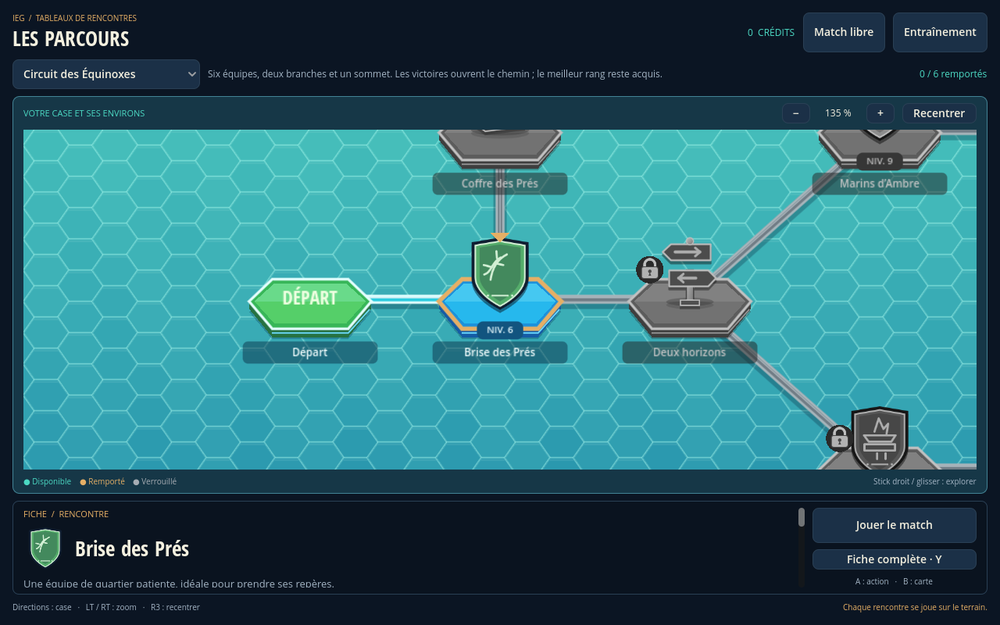
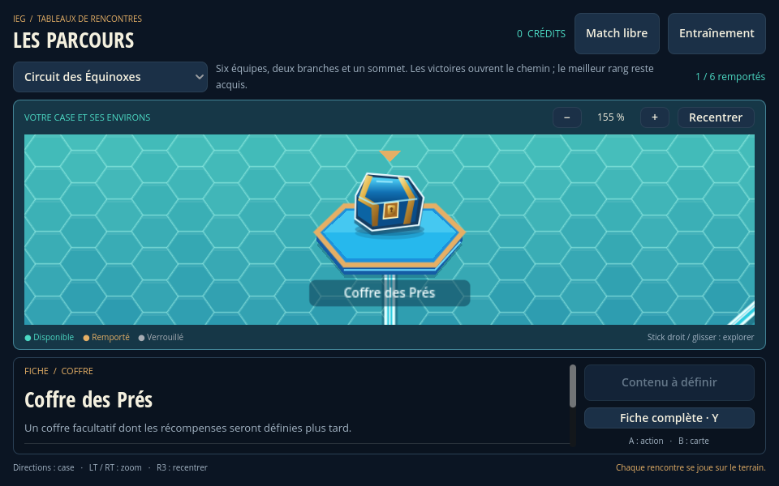
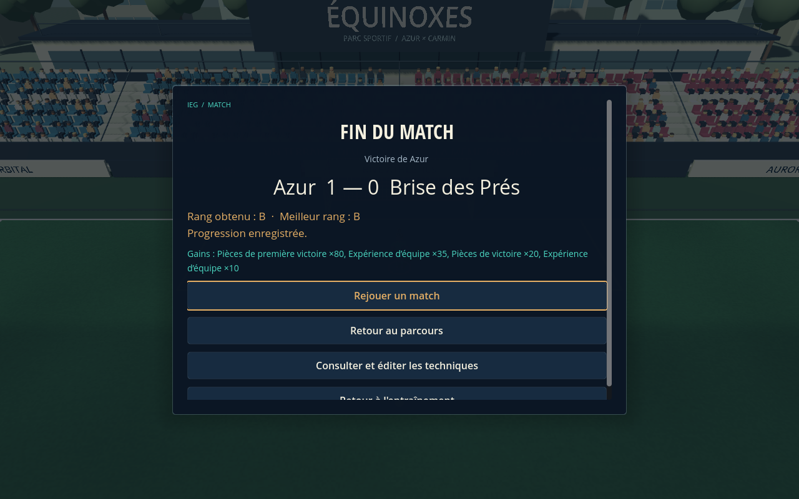
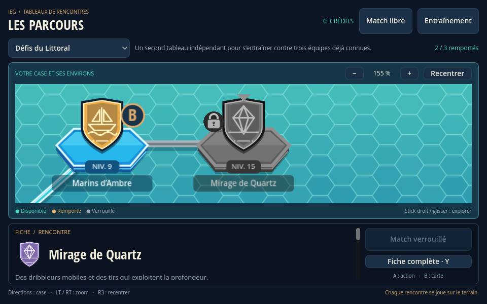

# Parcours jouables — 19 octobre 2026

F5 ouvre `scenes/routes.tscn`. Le tableau utilise des socles hexagonaux, de grands emblèmes et une mosaïque turquoise. La caméra démarre rapprochée et suit la case sélectionnée et ses environs. Les matchs inaccessibles, leurs emblèmes et les chemins qui y mènent sont entièrement grisés, même après une victoire sur le nœud précédent. Les fiches verrouillées restent consultables.

Sélectionner une case puis **Jouer le match**. La fiche compacte reste en bas ; **Fiche complète** permet de lire toutes les conditions et récompenses. Les actions restent visibles en petite fenêtre.

| Action sur le tableau | Manette | Clavier / souris |
| --- | --- | --- |
| Choisir une case et la centrer | Directions | Flèches, Tab ou clic |
| Donner le focus à l'action | A / Croix | Entrée / Espace |
| Agrandir / réduire la fiche | Y / Triangle | I, bouton Fiche complète |
| Revenir à la carte | B / Rond | Échap |
| Zoomer / dézoomer | RT / LT | Molette, boutons + / − |
| Explorer les environs | Stick droit | Glisser avec clic droit ou central |
| Recentrer la case | R3 | C ou bouton Recentrer |
| Faire défiler la fiche complète | Stick droit | Molette dans la fiche |

Le zoom choisi est conservé en changeant de case. Le centrage reste correct au redimensionnement et au retour au tableau. Les commandes A/B sont explicitement liées aux actions de validation/retour de Godot, tout en conservant Entrée, Espace et Échap.



Le Circuit des Équinoxes contient six équipes originales de onze joueurs, deux branches, une porte de mérite et un coffre final. La victoire initiale ouvre deux adversaires ; les deux branches doivent ensuite être gagnées et au moins l'une de leurs dernières rencontres doit avoir un rang A ou S pour atteindre le sommet. Le tableau secondaire Défis du Littoral propose une autre progression avec les mêmes équipes. Les matchs débloqués restent accessibles sans rejouer le chemin. Les identifiants, conditions et récompenses préexistants sont conservés ; seuls leur placement et leur présentation changent.

Trois coffres facultatifs ont été ajoutés sur les deux tableaux. Leur contenu est **à définir** : aucune récompense provisoire n'est inventée et ils ne peuvent pas être consommés. Configurer leur butin ultérieurement les rendra réclamables sans supprimer la progression ni les rangs. Les nouveaux coffres ne bloquent aucun match.



Les noms, emblèmes, couleurs, statistiques, techniques personnelles, vitesses, formation et paramètres IA de chaque adversaire viennent de `data/routes/demo_routes.json`. Les matchs durent deux périodes de 300 secondes de jeu, comme les rencontres libres. La mi-temps, les choix et les cinématiques suspendent le chrono selon les règles du moteur existant.

## Résultats et progression

| Résultat | Rang de la rencontre |
| --- | --- |
| Nul ou défaite | Aucun |
| Victoire avec 1 ou 2 buts d'écart | B |
| Victoire avec au moins 3 buts d'écart | A, sauf condition S |
| Au moins 5 buts marqués et aucun encaissé | S |

Les seuils sont centralisés dans `rank_rules` et le calcul dans `IEGRouteRank`. Le meilleur rang est monotone : B puis S puis A conserve S. Un nul ou une défaite après une victoire ne retire ni le rang ni les accès acquis. Aucun rang n'est affiché pour un match jamais gagné.

La fin du vrai match enregistre automatiquement le résultat avant de présenter les boutons de rejeu et de retour au parcours. Le tableau affiche ensuite le résultat et les gains. Chaque rejeu possède un nouvel identifiant ; réafficher le même résultat ne redistribue pas les récompenses. Abandonner un match ne donne rien et ne supprime pas la progression déjà enregistrée.

Les premières victoires donnent des gains garantis. Les gains répétables peuvent dépendre du rang et d'une probabilité. Monnaie, expérience par `content_key` et inventaires d'objets, techniques, équipements et éléments de recrutement sont conservés. Les coffres se réclament une seule fois.

**Limite RPG actuelle :** l'expérience est créditée dans un registre par joueur ; la montée de niveau, l'équipement et le recrutement ne disposent pas encore d'écrans ou d'effets de gameplay. Une technique gagnée entre dans l'inventaire, sans remplacer automatiquement le répertoire personnel d'un joueur. Cette livraison fournit les gains persistants et leurs points d'extension.

## Sauvegarde et architecture

La progression est dans `user://route_progress_v1.json`, distincte de `user://match_content.json` utilisé par l'atelier. Le format versionné conserve les accès, résultats, meilleurs rangs, coffres, gains, drapeaux et identifiants de matchs traités. Le dossier réel est accessible dans Godot via **Projet → Ouvrir le dossier des données utilisateur**.

L'écriture temporaire puis le remplacement atomique reprennent le mécanisme de sauvegarde du catalogue de techniques, extrait dans `IEGJsonStore` et partagé avec celui-ci. Une erreur restaure l'état mémoire et le RNG ; aucun gain n'est annoncé comme enregistré. Un fichier corrompu ou modifié par une autre instance est préservé. Le résultat propose une nouvelle tentative : après correction externe du fichier, celle-ci recharge la progression valide avant d'enregistrer le résultat. Aucune remise à zéro automatique n'est effectuée.

| Responsabilité | Fichiers |
| --- | --- |
| Données et validation | `data/routes/demo_routes.json`, `core/routes/route_catalog.gd` |
| Calcul de rang | `core/routes/route_rank.gd` |
| Accès, résultats et gains | `core/routes/route_progress.gd` |
| Sauvegarde atomique partagée | `core/persistence/json_store.gd` |
| Tableau, caméra locale et cases | `scenes/routes.tscn`, `scripts/routes/route_board.gd`, `route_tile.gd`, `route_connections.gd` |
| Liaison de scène | Autoload `RouteRun`, `scripts/routes/route_run.gd` |
| Match partagé | `scripts/match/full_match.gd`, `core/match/match_session.gd`, `core/player_profile.gd` |

`RouteRun` lie l'identifiant de parcours, le nœud, l'équipe et l'identifiant unique à l'instance réelle de session. Il refuse tout résultat avant `FINISHED` ou provenant d'une autre session/contexte. Les scores proviennent exclusivement de `session.team_goals` ; aucun score, vainqueur ou rang de démonstration ne figure dans le parcours jouable.

Le catalogue adapte `IEGMatchRoster` et `IEGPlayerProfile`. `configure_team()` initialise la formation, le nom et les paramètres de l'IA partagée avant le premier tick. Les duels configurés prennent en compte les statistiques de base autour de la référence 50, en plus des bonus existants ; les rencontres historiques non configurées conservent leur calcul. L'IA peut engager un tir de longue portée seulement si elle possède et peut payer une technique adaptée. Les alliés IA ne passent ni ne tirent et les règles de possession/sélection restent celles du moteur commun.

Pour ajouter du contenu, voir [le schéma du catalogue](../data/routes/README.md). Les conditions `requires` se cumulent ; `requires_any` propose une alternative. Un drapeau permet les conditions spéciales. Les arêtes servent au dessin ; les conditions déterminent les accès.

## Vérification

```bash
bash tools/validate.sh
```

Le script importe le projet dans Godot standard 4.7 puis lance les tests GDScript, les scènes existantes, le tableau et `tests/routes/scene_smoke.gd`. Les tests de rang couvrent les exemples 1–0, 3–1, 4–1, 5–2, 5–0, 7–0, 2–3 et 2–2 ainsi que la configuration des seuils. Les tests de progression couvrent persistance, B→S→A, accès AND/OR/rang/drapeau, gains uniques, chances, doubles appels, corruption, concurrence et restauration après erreur d'écriture.

Résultat sous `4.7.stable.official.5b4e0cb0f` : **425/425 tests natifs** (dont 40 spécifiques aux parcours), **38/38 contrôles de carte et de caméra**, **29/29 contrôles de boucle parcours**, **32/32 contrôles de scène match**, **22/22 contrôles de menus Karma/Résonance**, **12/12 contrôles d'entraînement**, **81 contrôles de prévisualisation** et **7/7 diagnostics**. Import et démarrages réussis, sans erreur moteur/script.

`tests/routes/board_smoke.gd` vérifie centrage proche/éloigné, zoom borné et conservé, glisser/recentrage, redimensionnement, découpage de la carte, navigation DPAD/A/Y/B, actions visibles, désaturation et chemins verrouillés malgré une victoire en amont. Son exécution OpenGL ajoute cinq captures : **43/43 contrôles réussis**. Les rangs de ses captures sont des fixtures de progression isolées, sans modifier la sauvegarde normale ou le résultat d'une rencontre. Les coffres en attente sont testés avant et après configuration de leur contenu.

Le test de boucle appuie sur les vrais boutons, lance `FullMatch`, utilise le franchissement physique de la ligne pour marquer et parcourt les deux périodes jusqu'à `FINISHED`. Il vérifie victoire, nul, défaite, sauvegarde, déblocage, retour et rejeu. **Fixtures de test uniquement :** chrono raccourci et ballon placé près de la ligne ; aucun score ou rang n'est affecté directement. Les matchs du mode jouable conservent leur durée complète.





Les captures utilisent OpenGL Compatibility sous écran virtuel avec Mesa llvmpipe et audio Dummy. La manette est exercée par événements injectés ; aucun matériel physique n'est branché. La vérification ne remplace pas un playtest humain d'une rencontre complète ou une mesure sur GPU joueur. Les limites générales du match (règles de sortie simplifiées notamment) restent celles documentées dans [FULL_MATCH.md](FULL_MATCH.md).
