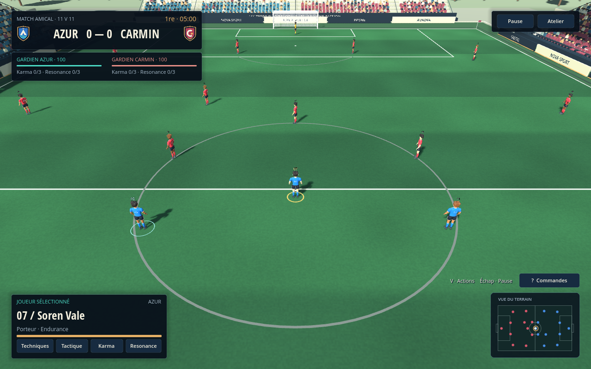
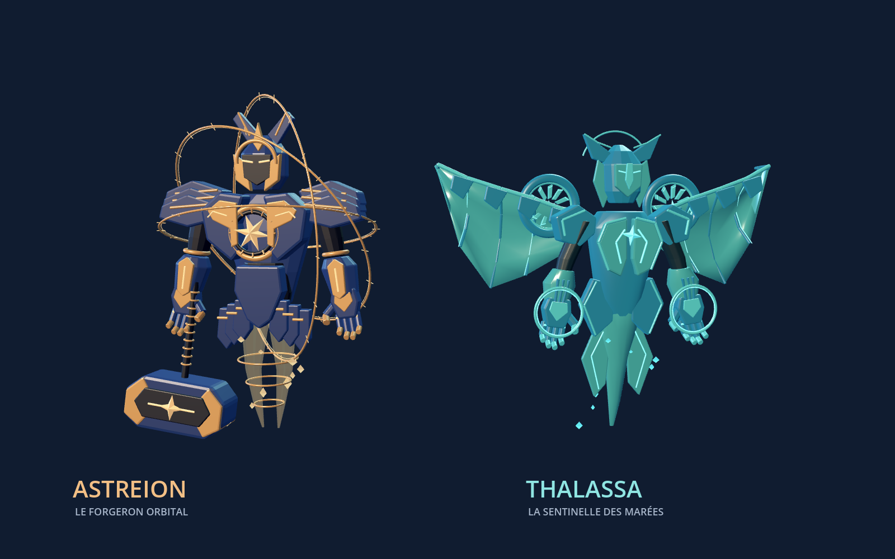
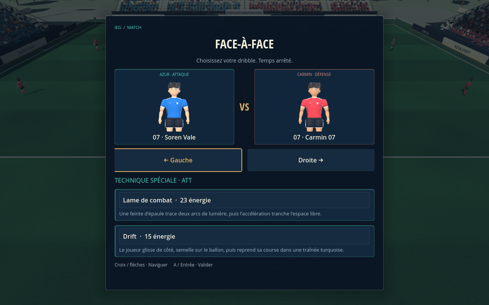
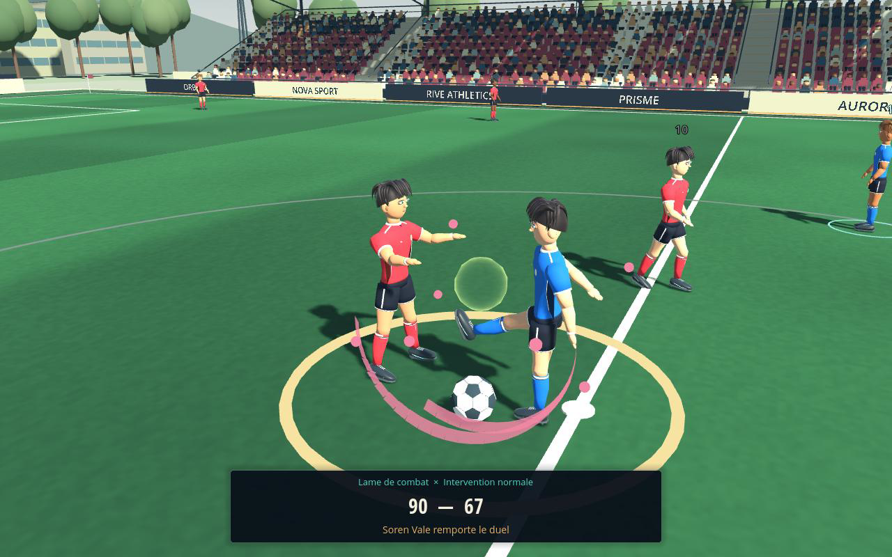
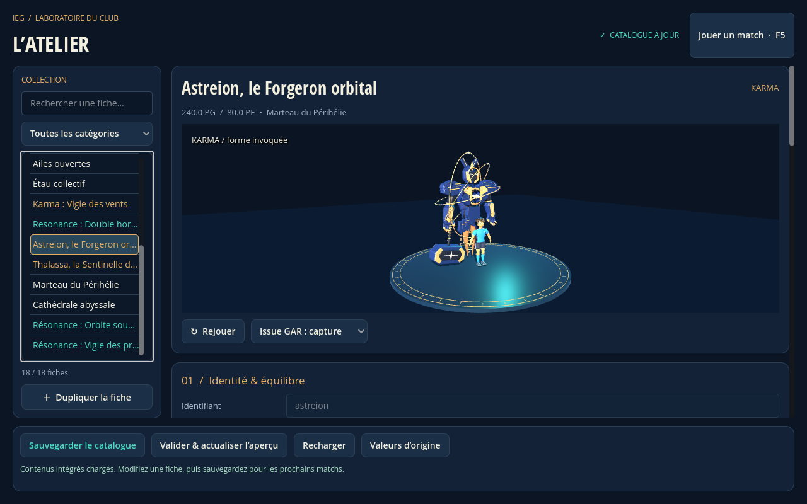

# Refonte visuelle — 16 octobre 2026

Le match adopte une direction sportive stylisée commune : bleu nuit, crème, cuivre et turquoise. Les changements portent sur la présentation et les assets ; les règles de simulation, les ressources PG/PE et l'héritage des Résonances restent inchangés.

## Rendu en jeu



Le Parc des Équinoxes remplace les anciennes bandes de tribunes : gradins, rangées de sièges, public, escaliers, garde-corps, toitures courbes, bancs techniques, pavillon presse, panneaux fictifs et parc environnant. Le gazon dispose d'un shader propre au match, avec tonte et variations fines. L'éclairage est moins saturé, avec des ombres mieux définies.

Les 3 504 sièges et 2 644 spectateurs sont regroupés en MultiMesh. Les petits éléments de foule ne projettent pas des milliers d'ombres ; les joueurs, bâtiments et structures conservent leurs ombres. Le stade reste décoratif, sans nouveaux colliders ni changement du terrain de 60 × 90 m ou des buts.

La caméra du match se rapproche légèrement avec un champ de vision de 56°, pour mieux lire les joueurs. Le radar montre le placement hors champ. L'entraînement conserve son shader et les réglages de caméra précédents.

## Personnages et Karma

Le nouveau `footballer_polished.glb` conserve les 18 os et les animations Idle, Walk, Run et Kick. Le maillot possède col, panneaux, bordures et écusson ; les chaussures ont semelles, crampons et lacets. Le visage et la coiffure sont reconstruits. Les profils continuent de piloter les couleurs de tenue, de peau et de cheveux. Le numéro du maillot suit le torse ; les indicateurs flottants sont plus discrets.



Astreion et Thalassa utilisent de nouveaux modèles GLB à pièces articulées : armures modelées, mains détaillées, casque, fournaise, marteau, orbites gravées, ailes manta courbes et turbines. Les palettes, la hauteur et les issues d'animation restent pilotées par le catalogue. Les Résonances utilisent des rubans et marques plus fins. Le ballon des cinématiques reprend les panneaux du ballon live ; les impacts lumineux laissent mieux voir l'action.

Les anciens GLB sont conservés dans le projet. Les nouvelles géométries sont originales, construites avec les outils du dépôt. Aucun addon Blender ou Python n'est requis pour jouer : les modèles sont exportés en GLB et le projet fonctionne en Godot standard/GDScript.

## Interface et atelier



Le HUD regroupe score, chrono et gardiens en une régie compacte. La fiche du joueur s'adapte aux transformations actives et garde les réserves PG/PE séparées. Les commandes détaillées sont rétractées par défaut. Les menus utilisent des cartes lisibles, des écussons et une navigation manette avec focus marqué. Les duels présentent les portraits 3D des deux joueurs ; ces viewports ne rendent qu'à la création ou au redimensionnement.





L'atelier dispose d'une recherche, d'un filtre de catégories, d'une fiche structurée, de formulaires espacés et d'actions persistantes. L'aperçu montre le véritable joueur riggé et les mêmes Karma que le match, dans un studio éclairé. Les copies, sauvegardes, rechargements et héritages gardent leurs contrats précédents. Le badge de sauvegarde suit l'état réel du catalogue.

Quand l'atelier embarqué est ouvert, le stade est suspendu visuellement derrière son panneau opaque ; son studio garde son propre viewport 3D. Le rendu du match est restauré à la fermeture.

Les interfaces sont vérifiées en **1280 × 800** et **960 × 600**. Le match et l'atelier autonome adaptent leur taille logique aux petites fenêtres ; le retour à l'entraînement restaure le réglage précédent. Les polices Open Sans sont distribuées avec leurs notices et le texte complet Apache 2.0.

## Validation exécutée

```bash
bash tools/validate.sh
```

Godot `4.7.stable.official.5b4e0cb0f` : **385/385 tests natifs**, **32/32 contrôles de scène match**, **22/22 contrôles de menus Karma/Résonance**, **12/12 contrôles d'entraînement**, **81 contrôles de prévisualisation** et **7/7 diagnostics**. Import et démarrages réussis sans erreur moteur/script.

Des vérifications supplémentaires ont exercé les filtres de l'atelier, le focus, les portraits après redimensionnement, l'absence de débordement et les poses du nouveau modèle. Les rendus réels utilisent OpenGL Compatibility 4.5/Mesa llvmpipe sous écran virtuel. L'avertissement VSync du pilote n'empêche pas le rendu ; l'audio utilise le pilote dummy.

Un aperçu moteur automatisé de 13,25 secondes a également été enregistré et monté : déplacement live, duel préparé puis prévisualisation de signature gardien. Il montre les assets réellement rendus dans Godot ; ce n'est pas un playtest humain d'un match entier. Une première capture longue a atteint la limite de temps du rendu logiciel ; le montage livré utilise ses séquences décodables et une capture gardien terminée normalement.

Un instantané de la scène à 1280 × 800, avec les 22 joueurs, compte environ **1,18 million de primitives et 1 448 appels de rendu**, passes d'ombre comprises. Ce relevé est une charge de rendu, pas une mesure de FPS sur le matériel du joueur.

## Fichiers et reconstruction

| Partie | Fichiers principaux |
| --- | --- |
| Stade et gazon | `scripts/match/match_arena.gd`, `assets/environment/match_pitch.gdshader` |
| Joueur | `assets/characters/footballer_polished.glb`, `scenes/characters/player_view.tscn`, `scripts/presentation/player_view.gd` |
| Karma | `assets/karma/`, `scripts/presentation/modifier_visual.gd` |
| Interface | `match_hud.gd`, `visual_theme.gd`, `tactical_radar.gd`, `player_portrait.gd`, `assets/ui/` |
| Atelier | `scripts/editor/content_editor.gd`, `scripts/editor/technique_preview.gd` |
| Caméra et impacts | `full_match.gd`, `orbit_camera.gd`, `duel_cinematic.gd`, `assets/vfx/energy_shell.gdshader` |

Pour reconstruire les modèles avec Blender 4.3 ou ultérieur :

```bash
blender --background --python tools/art/build_footballer.py
blender --background --python tools/art/build_spirits.py
```

Ces commandes d'outillage ont été exécutées pour produire les assets. Voir [tools/art/README.md](../tools/art/README.md) et [assets/karma/README.md](../assets/karma/README.md).

Le joueur utilise encore une géométrie et une coiffure communes, recolorées par profil ; il n'a pas de rig facial. Le public est statique. L'art et les animations demandent encore des finitions, et aucun essai de manette physique ni mesure de performance sur GPU joueur n'a été effectué dans ce cloud.
